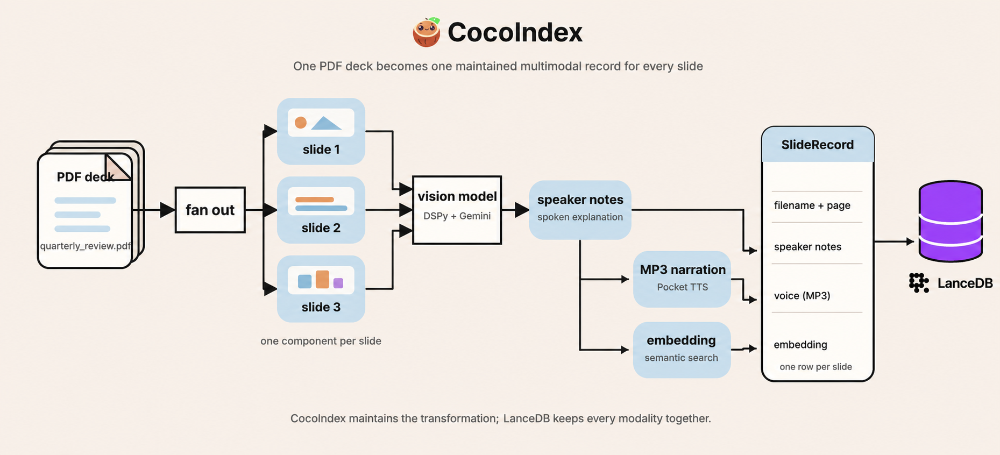

# From Slide Deck to Searchable Narration with CocoIndex and LanceDB

## The synchronization problem hiding inside a fun demo

Presentation slide decks are information-rich, dense sources of company knowledge, containing everything from quarterly updates, technical specs, sales reports, and training materials. These decks are locked away in PDF files that get revised constantly and are generally hard to consume in their static form.

What if we could turn those decks into a continuously updated, searchable, and narrated (audio) knowledge base? Doing that would result in a few immediate benefits:

- **Listen to any slide deck** instead of reading every slide (useful for busy executives on the go, and for people with visual impairments).
- **Extract insights from slide content** as structured speaker notes by using a VLM (vision language model).
- **Search slide content semantically**, not just by keywords or filenames.

Producing those artifacts once is only half the task. When a deck changes, its speaker notes, audio, and embeddings also have to be kept fresh. Once everything is in sync, it can lay the foundation for more advanced user experiences later, including video generation from text.

In this post, we’ll show how to turn the slide deck's assets into a multimodal knowledge base stored in LanceDB: the same dataset contains the slide content, speaker notes, MP3 audio narration, and embeddings for vector search, all of which are orchestrated and kept fresh by CocoIndex.

## Introducing CocoIndex

CocoIndex is an ultra-performant framework that keeps context continuously fresh for AI Agents. Think “React for data processing.” You declare state transformations, and CocoIndex handles the processing logic: it continuously watches for changes, recomputes only what’s necessary, and applies minimal updates downstream for end-to-end freshness. As AI systems become increasingly autonomous, the bottleneck is no longer model capability: it’s keeping context fresh and relevant.

CocoIndex follows an incremental update philosophy:

- New slide decks appear in the source folder
- Updated files get reprocessed automatically
- Only affected rows get new embeddings and regenerated audio, if needed

## Introducing LanceDB

[LanceDB](https://docs.lancedb.com) is a multimodal lakehouse for AI, available as an open-source, embedded, developer-friendly retrieval library that pairs well with CocoIndex. Under the hood, it’s powered by the Lance columnar format, which is designed for fast random access (great for search workloads) without sacrificing scan performance (great for large-scale aggregation queries).

For this Slides-to-Speech pipeline, that translates into a few concrete benefits:

- Multimodal in one table: store speaker notes, MP3 audio bytes, embeddings, and metadata side by side as a single dataset.
- Indexes are first-class: vector search, full-text search (FTS), and secondary indexes are stored alongside your dataset, so you don’t need to manage those using separate systems.
- Data evolution: add or refine columns over time (backfill new embeddings, quality tags, moderation fields) without touching unmodified columns, which is great for feature engineering and experimentation.
- Local-first simplicity: run it as an embedded database with minimal operational overhead.

CocoIndex's LanceDB connector automatically appends and updates rows as new results arrive via the CocoIndex pipeline, so you don’t have to rewrite your table (or rebuild your indexes) from scratch each time content changes.

## What we are building: one slide, three derived modalities

To begin building our pipeline, let's first get the shape of the data clear. A PDF slide deck doesn’t just become one large database record. We first fan it out page by page, then turn each slide into three related outputs: speaker notes, MP3 narratio (audio), and a text embedding for semantic search.



The speaker notes sit at the center of the pipeline, but they first need to be generated by a vision model that reasons over the slide content. Once they exist, audio generation and embedding can run on them concurrently. The completed outputs are then declared together as one `SlideRecord`, identified by its filename and page number.

Each tool has one focused job:

| Component | Role in the pipeline |
| --- | --- |
| **CocoIndex** | Discovers PDFs, runs the transformations, and reconciles the declared slide rows with the source files. |
| **PyMuPDF** | Renders every PDF page as a PNG for the vision model. |
| **DSPy + Gemini** | DSPy lets us call the VLM via a concise signature, and the VLM (`gemini/gemini-2.5-flash`) reads each rendered slide PNG and writes the speaker notes. |
| **Pocket TTS** | Synthesizes those notes as MP3 audio locally on the CPU. |
| **Sentence Transformers** | Embeds the speaker notes locally with `sentence-transformers/all-MiniLM-L6-v2`. |
| **LanceDB** | Stores text, binary audio, metadata, and vectors together, then searches the notes by meaning. |

Most of the pipeline runs locally on CPU: PyMuPDF renders the pages as images for the VLM, [Pocket TTS](https://github.com/kyutai-labs/pocket-tts) synthesizes audio from the speaker notes, `sentence-transformers` generates text embeddings, and LanceDB runs as an embedded, local retrieval library.

## Start backwards from the target

CocoIndex pipelines are easiest to reason about _backwards_ from the target, i.e., where the data sits in its final form. Put simply, `target_state = transformation(source_state)`, where `transformation` can be any function, or a set of functions. For this pipeline, the target state is one clean LanceDB row for **each slide**.

```python
# Declare the LanceDB table shape via a strictly typed schema
# Pydantic or PyArrow schemas work well, but dataclasses are simpler for this example
@dataclass
class SlideRecord:
    id: str
    filename: str
    page: int
    speaker_notes: str
    voice: bytes
    embedding: Annotated[NDArray, EMBEDDER]

# Mount a LanceDB table as the target
table = await lancedb.mount_table_target(
    LANCE_DB,
    table_name="slides_to_speech",
    table_schema=await lancedb.TableSchema.from_class(
        SlideRecord,
        primary_key=["id"],
    ),
)
```

**Multimodal data is a first-class citizen in LanceDB.** Each row can hold the slide’s metadata, generated notes, MP3 narration bytes, and vector embedding side by side. `SlideRecord` is the typed contract that keeps those values together, via a dataclass.

Each slide needs a stable primary key so CocoIndex can match it to the same LanceDB row across runs, updating or removing the correct record as the source changes. This example derives that key from the filename and page number: page 3 of `quarterly_review.pdf` becomes `quarterly_review.pdf#3`.

## Functions vs. processing components

Incremental processing is only useful when its boundaries match the unit of change. We want our pipeline to run every time a change is detected in the source files, without wastefully recomputing what didn't change.

In CocoIndex, functions define the work, while processing components group that work into independently synchronized units. Where we draw those component boundaries determines how much of the pipeline runs each time a change is detected, and which target states CocoIndex reconciles afterward.

- **Functions** are decorated with `@coco.fn`. They remain callable Python functions, while `memo=True` lets CocoIndex _memoize_ (i.e., reuse results for) unchanged inputs. Several functions can run inside the same processing component.
- **Processing components** are created by grouping functions and _mounting_ them to the target. They manage the necessary function calls and the target states they declare. Processing components help decide the granularity at which CocoIndex reruns work and synchronizes the result.

In this example, we define the processing component at the **per-slide level**, through the `process_file` function. It takes a PDF file, renders each slide as an image, and mounts one `process_slide` function for each slide.

```python
@coco.fn
async def process_file(
    file: FileLike,
    table: lancedb.TableTarget[SlideRecord],
) -> None:
    slides = await pdf_to_slides(await file.read())
    await coco.mount_each(
        process_slide,
        ((slide.page_number, slide) for slide in slides),
        str(file.file_path.path),
        table,
    )
```

`process_slide` is declared with `@coco.fn(memo=True)`, which lets CocoIndex apply _memoization_: it reuses the result when its tracked inputs are unchanged. Each slide component then goes through note generation, TTS, embedding, and the declaration of one `SlideRecord` based on its stable key.

Changing a slide in a PDF still reruns page rendering for that entire file (PyMuPDF is a cheap CPU-based operation, with no VLM calls yet). Once the images are available, CocoIndex fingerprints files with a content-based hash, so it processes _only_ slide images whose contents changed from the previous state. This is the power of memoization and the reason we mount the component at the slide level.

If the PDF disappears, its component and all of its slide components disappear with it.

Let's now go over each stage of the pipeline below.

## Fan a PDF out into slides

The function `pdf_to_slides` turns the PDF bytes into typed `SlidePage` values, each carrying the page number and the rendered PNG that the vision model will inspect.

```python
@dataclass
class SlidePage:
    page_number: int
    image: bytes

@coco.fn(memo=True)
def pdf_to_slides(content: bytes) -> list[SlidePage]:
    import pymupdf

    slides: list[SlidePage] = []
    doc = pymupdf.open(stream=content, filetype="pdf")
    for i, page in enumerate(doc):
        pix = page.get_pixmap(matrix=pymupdf.Matrix(2, 2))
        slides.append(
            SlidePage(page_number=i + 1, image=pix.tobytes("png"))
        )
    doc.close()
    return slides
```

PyMuPDF renders each page at 2× scale, so the vision model sees a legible PNG rather than extracted PDF text. The image is an intermediate input: Gemini uses it to generate notes, but the pipeline discards it afterward. If you want to keep the rendered image for reuse, you can add an `image` field and store its bytes in the same LanceDB table.

## Turn a slide image into narration

Extracting speaker notes from the slide images gives the TTS model the text it needs. This step effectively turns the script into an audio file that narrates the insights from that slide. Text embeddings are also generated from the speaker notes, so they can support semantic search, allowing you to easily find slides based on their meaning rather than just keywords in their titles or filenames.

```python
class SlideNotes(dspy.Signature):
    """Write natural spoken narration for a slide, as a presenter would say it aloud."""

    slide: dspy.Image = dspy.InputField(desc="the rendered slide image")
    speaker_notes: str = dspy.OutputField(
        desc="a few sentences of spoken narration — no markdown or bullet symbols"
    )

_speaker_notes = dspy.Predict(SlideNotes)

@functools.cache
def _get_lm(model: str) -> dspy.LM:
    return dspy.LM(model, max_tokens=8192)

@coco.fn(memo=True)
async def extract_speaker_notes(image: bytes) -> str:
    data_url = "data:image/png;base64," + base64.b64encode(image).decode()
    with dspy.context(lm=_get_lm(coco.use_context(LLM_MODEL))):
        result = await _speaker_notes.acall(slide=dspy.Image(url=data_url))
    return result.speaker_notes
```

`SlideNotes` is a DSPy signature, a typed contract that tells the VLM what we need. When a slide image comes in, speaker notes come out. The CocoIndex function `extract_speaker_notes` does the actual work of turning the PNG bytes into a text output.

This extraction function is memoized because speaker-note generation is an expensive dependency － it calls a capable VLM to reason over the image. Its memoization key includes the rendered image and the change-detected `LLM_MODEL` context, so an unchanged slide can reuse its notes if the image bytes and the model remain the same. If either of them changes, it's tracked by CocoIndex and the work is rerun for that slide.

## Turn speaker notes into audio and embeddings

We can now inspect the function `process_slide` and the work it does, by reading it top to bottom. The speaker notes must exist, so the `extract_speaker_notes` function is called first. Once they exist, audio synthesis and embedding have no dependency on each other, so we call `asyncio.gather` to run them concurrently. CocoIndex commits them to the LanceDB table only after both are ready.

```python
@coco.fn(memo=True)
async def process_slide(
    slide: SlidePage,
    filename: str,
    table: lancedb.TableTarget[SlideRecord],
) -> None:
    notes = await extract_speaker_notes(slide.image)
    voice, embedding = await asyncio.gather(
        text_to_speech(notes, coco.use_context(TTS_VOICE)),
        coco.use_context(EMBEDDER).embed(notes),
    )
    table.declare_row(
        row=SlideRecord(
            id=f"{filename}#{slide.page_number}",
            filename=filename,
            page=slide.page_number,
            speaker_notes=notes,
            voice=voice,
            embedding=embedding,
        )
    )
```

The target state is declared as a `SlideRecord` dataclass (per the LanceDB schema) keyed by its unique ID that combines the filename and page number. This is how CocoIndex reconciles the target state with the source files, updating or removing rows as needed.

## Define the app

Apps are the top-level runnable unit in CocoIndex. They name your pipeline and bind a `main` function with its parameters. When you call `app.update()`, CocoIndex runs that main function as the root processing component that can mount processing components (like our `process_file` and its child component `process_slide`) that do work and declare target states.

`app_main` mounts the `SlideRecord` table we defined earlier, uses `localfs.walk_dir` in live mode to discover PDFs, then calls the outer `mount_each`. The app is configured with a name, the main function, and the source directory to watch for changes.

```python
app = coco.App(
    coco.AppConfig(name="SlidesToSpeech"),
    app_main,
    sourcedir=pathlib.Path("./slides"),
)
```

## Run the pipeline and run semantic search

### Prerequisites

- Python 3.11+
- A Gemini API key for the default vision model
- `ffmpeg` for MP3 export

Pocket TTS is open source and runs locally on the CPU. Its weights download on the first run, so it needs neither a TTS API key nor a GPU.

### Quick start

From the example directory, copy the environment file, set `GEMINI_API_KEY`, and ensure `LLM_MODEL=gemini/gemini-2.5-flash` to match the example’s default configuration. Then install and run:

```sh
cp .env.example .env
uv sync
cocoindex update main

# Keep watching slides/ for changes instead:
cocoindex update -L main
```

### Search the deck

```sh
python main.py "reducing latency and reliability"
```

The query helper embeds the question with the same sentence-transformer, then asks LanceDB for its nearest neighbors. The results already arrive ranked, so we can print the matching slide and its notes directly:

```python
for row in table.search(vec).limit(5).to_list():
    print(f"{row['filename']} slide {row['page']}")
```

The slide deck we use here is an example "quarterly-review" deck, so the query about "reducing latency and reliability" brings the slide about "Engineering Priorities" to the top because its notes discuss "reducing p95 latency and multi-region resilience".

The returned row also can fetch the `voice` bytes, so a downstream application can use those bytes as `audio/mpeg`, write them to an MP3 file for playback, and play them on demand if needed.

<!--
TODO (astro-audio-demo):

We can let the reader play the audio directly in the blog post. The following snippet
is a placeholder for an Astro component that will render a native audio player for the MP3 file.
It will be replaced with a working demo when this post moves to the Astro site.

When this post moves to the Astro site, copy these exported
assets into the blog's local asset directory:

- audio/quarterly_review_slide_1.mp3
- audio/quarterly_review_slide_2.mp3
- audio/quarterly_review_slide_3.mp3

Add a compact audio demo beside this result. Adjust the import path to the Astro repo's
asset convention, then use a native player such as:

  import engineeringPrioritiesAudio from "./assets/quarterly_review_slide_2.mp3";

  <audio controls preload="metadata">
    <source src={engineeringPrioritiesAudio} type="audio/mpeg" />
    Your browser doesn't support MP3 playback.
  </audio>

The proposed audio player to embed in Astro would be a native <audio> element,
so it shouldn't need an npm package install, custom component library, backend,
or JavaScript player.
Astro can bundle the imported MP3 as a static asset. Each sample is roughly
190–200 KB, and preload="metadata" avoids downloading the full audio until
the reader presses play.
-->

## How CocoIndex tracks changes

In this demo, CocoIndex watches the `./slides` directory for changed PDFs. It then identifies the changed slides, and only those slides regenerate notes, audio, and embeddings. As the table above shows, it can track much more than file changes.

However, source files changing is only one such scenario. The table below shows the other changes that CocoIndex tracks, and what they mean for other pipelines like this one.

| Change | What it means in this pipeline |
| --- | --- |
| Nothing | Memoized calls reuse their prior results and retain their rows. |
| One slide changes inside a PDF | The PDF renders again, then only the slide with different PNG bytes reruns notes, TTS, embedding, and its row declaration. |
| A PDF is added or deleted | CocoIndex creates or removes the file component and all of its owned slide rows. |
| LLM model, embedder, or voice changes | The change-detected context refreshes the functions that consume it; unrelated memoized calls can be reused. |
| Decorated function logic changes | A changed `@coco.fn` fingerprint invalidates memoized calls that depend on that function, then CocoIndex reconciles the resulting rows. |
| `SlideRecord` fields or primary key change | The target contract has changed. Treat compatibility, backfill, and identity changes as a deliberate migration decision. |

## Bring your slides to life (and beyond)

The pipeline shown here is a concrete example of how to bring slide decks to life via narration. But don’t just think of organizational data as scalar tables and flat text. A large amount of company intelligence is locked away in richer artifacts like PDF reports, dashboards, and video recordings.

With CocoIndex and LanceDB, we can turn _all_ of that raw multimodal content into a living, breathing, contextually rich knowledge base that agents can retrieve from:

- **Unify multimodal content in one storage layer:** text, audio, vectors, and metadata in the same table.
- **Add structure that supports more questions:** speaker notes, extracted fields, embeddings, tags, and other derived signals.
- **Keep everything synchronized over time:** incremental recomputation when source files change, with updated rows in LanceDB.
- **Build user-facing experiences on top:** semantic search, narrated slide playback, assistants, and video-generation pipelines.

Try the [complete slides-to-speech example](https://github.com/cocoindex-io/cocoindex/tree/main/examples/slides_to_speech) with your own deck, then star [CocoIndex](https://github.com/cocoindex-io/cocoindex) and [LanceDB](https://github.com/lancedb/lancedb) on GitHub.

---

## Frequently asked questions

### How do I turn slide decks into narrated audio automatically?

This pipeline watches a local `slides/` folder for new and updated PDFs, renders each page to an image, writes structured speaker notes with a vision model, synthesizes narration, embeds the notes for search, and stores everything in LanceDB. The result is a continuously updated, searchable multimodal dataset of slide metadata, speaker notes, MP3 audio, and embeddings.

### How are speaker notes extracted from slide images?

Each PDF page is rendered to a PNG at 2× scale with PyMuPDF, then passed to a `SlideNotes` DSPy signature backed by the configured vision model. The signature defines a slide-image input and spoken-notes output; Gemini 2.5 Flash is the default model.

### What text-to-speech engine does the slides-to-speech pipeline use?

It uses [Pocket TTS](https://github.com/kyutai-labs/pocket-tts), a neural TTS engine that runs fully locally on the CPU without requiring a cloud API or GPU. The model and voice state are cached, and its audio is exported to MP3 with `pydub` and `ffmpeg`; the `coco.GPU` runner serializes the blocking call off the event loop.

### How do I store images, text, audio, and embeddings together?

[LanceDB](https://docs.lancedb.com) stores multimodal data natively, so each slide becomes one row with its filename, page number, speaker notes, MP3 bytes, and embedding side by side. The current `SlideRecord` doesn't store the rendered image, but you can add an image field to the schema if you need it.

### What happens to the narration when a slide changes?

CocoIndex tracks the PDF input, decorated-function logic, and change-detected configuration. A changed PDF is rendered again, then only pages with different rendered bytes regenerate their notes, MP3 narration, embedding, and LanceDB row; other slide components keep their prior results.

### How do I serve slide audio and images to a frontend?

Once the slide rows are in LanceDB, a lightweight application can fetch the MP3 bytes in `voice` and return them as `audio/mpeg` for a player. This example doesn't include that API and doesn't store the rendered image, but both are small extensions to the current data model.
